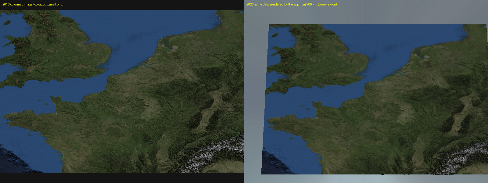
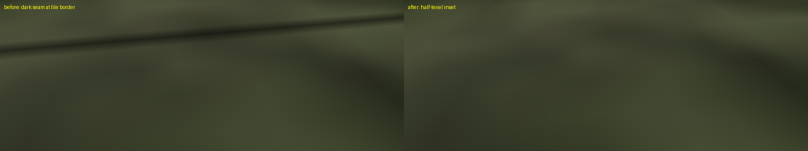
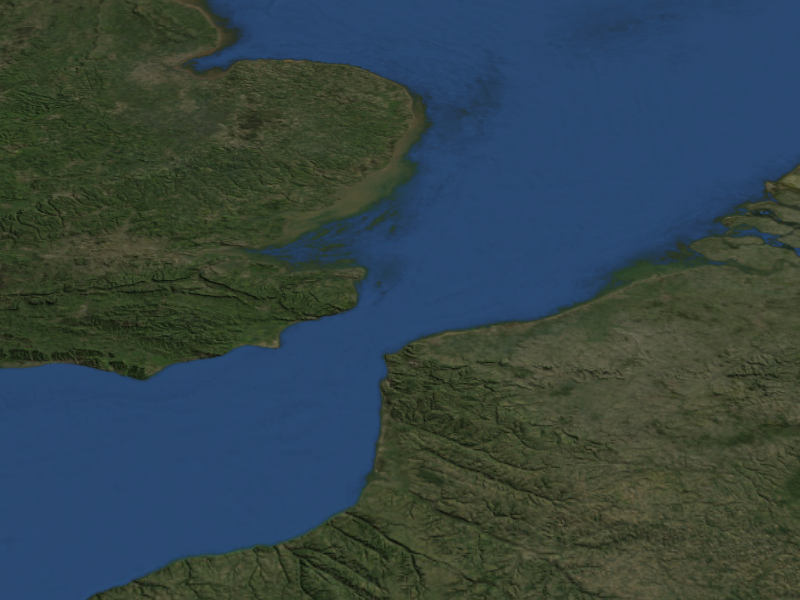
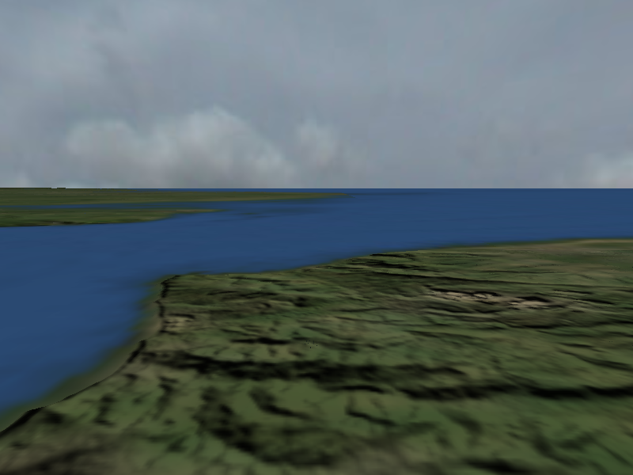

# irrbigmap

A C++ framework for rendering **very large terrain maps** in the
[Irrlicht](https://irrlicht.sourceforge.io/) 3D engine. The included demo map covers
Europe (about 1,600 × 1,070 km) using real 90 m resolution NASA SRTM elevation data.



## Background: a 2013 project, brought back in 2026

irrbigmap is a project I wrote in 2013. It took me **more than three months** of
evenings and weekends. The original lives on SourceForge:
<https://sourceforge.net/projects/irrbigmap/>.

In 2026 I pulled it back to life using [Claude Code](https://claude.com/claude-code).
In a couple of days it was building and running on a current Linux system again,
several bugs were fixed, and it gained a new feature: an overview of the whole map when
you fly high. This repository is that refresh. The original idea and the core design
(tiled terrain, floating origin, threaded tile loading) are from 2013. The
modernisation, fixes and the overview were done with Claude Code.

## How it works

- The big heightmap and colour map are cut into overlapping tiles of 129 × 129 pixels
  (one tile is about 11.5 km). The map is 140 × 93 tiles.
- Only a small grid of tiles around the camera is loaded (5 × 5 by default). Tiles
  are loaded on background threads (`boost::thread`) and spread over several frames,
  so flying doesn't stutter.
- A floating origin keeps coordinates small: when the camera crosses into a new tile,
  the loader recycles the tile slots and moves the camera back, so there is no
  precision loss over long distances.
- **New in 2026:** a low-resolution *overview* of the whole map is drawn behind the
  detailed tiles, so from high up you see the whole of Europe, not just a 57 km patch.

Source layout: `src/TiledTerrain.*` (tile loader), `src/OverviewTerrain.*` (distant
terrain), `src/main.cpp` (demo application). Notes on making new maps from SRTM data
are in [src/doc/heightmap.howto](src/doc/heightmap.howto).

## What was fixed and added in 2026


| | |
|---|---|
| **Builds on current systems** | The 2013 code compiled unchanged against Irrlicht 1.8.5 and Boost 1.90. The Makefile was rewritten for Linux. |
| **Black lines between tiles** | Two causes: the wrap-mode call takes a `bool`, so the intended clamp-to-edge became a clamp that blends with a black border; and each 129 px tile is stretched over 128 quads, so filtering sampled past the texture edge. Fixed with an explicit wrap mode and a half-texel inset. |
| **Crash at the map edge** | The tile grid could leave the map and index out of range. The original segfaulted when flying past the north, south or east edges. Fixed; tested on four edges, a corner and a normal start. |
| **Thread race and leaks** | A new cache thread could start while the old one was still writing, and a few buffers were leaked or deleted with the wrong `delete`. |
| **Wrong map size** | `main.cpp` had rows and columns swapped (the map is 93 rows × 140 columns). |
| **Distant overview (new)** | The whole map is drawn as 216 low-resolution chunks behind the detailed tiles. 60 FPS on Intel Iris Xe. |

Seams before and after:



The overview from 250 km up, and the join between detailed tiles and the overview:




Not tested: Windows, other GPUs and drivers, and long interactive flights. The old
Visual Studio project was removed because it could not be tested; a CMake build would
be the natural way to add Windows support.

## Running it on Ubuntu

Tested on Ubuntu with g++, Irrlicht 1.8.5, Boost 1.90 and Mesa (OpenGL 4.6).

```bash
# 1. dependencies
sudo apt install g++ make libirrlicht-dev libboost-thread-dev libboost-date-time-dev

# 2. get the map data (see "Map data" below) into media/

# 3. build and run
cd src
make run
```

The program asks which video driver to use; choose OpenGL. `make` alone builds
`bin/bigmap`; it must be started from the `media/` directory because it loads
`media/...` relative to the current directory (`make run` does that for you).

### Map data

`media/color.zip` (254 MB) and `media/heightmap.zip` (32 MB) are too large for the git
repository and are distributed as release assets. Download both from the project's
GitHub Releases page and put them in `media/`. The data licences are in
[src/license/](src/license/).

The overview images (`media/overview_height.png`, `media/overview_color.jpg`) are
included. To regenerate them from the zips (about 35 s; needs Python, numpy and Pillow):

```bash
make -C src overview
```

If they are missing, the program prints a hint and runs without the overview.

## Controls

| Key | Action |
|---|---|
| Mouse / arrow keys | Look around / move (Irrlicht FPS camera) |
| `1` – `5` | Jump to 2 m, 10 m, 5,000 ft, 20,000 ft, 40,000 ft above the terrain |
| `0` | Jump to 300 km altitude (best view of the overview) |
| `O` | Toggle the distant overview |
| `6` – `9` | Camera speed 0.1, 1, 20, 50 |
| `W` | Wireframe |
| `P` | Point rendering mode |
| `D` | Toggle detail map |
| `X` | Toggle debug information |
| `Q` | Quit |

## Licence

The code is MIT licensed. Individual media files have their own licences; see
[src/license/readme](src/license/readme).

José Santos
